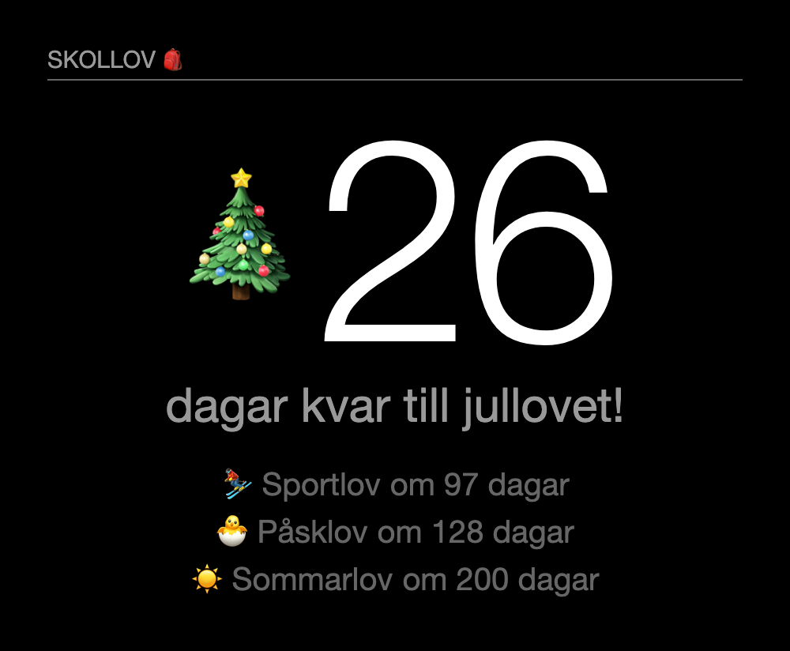
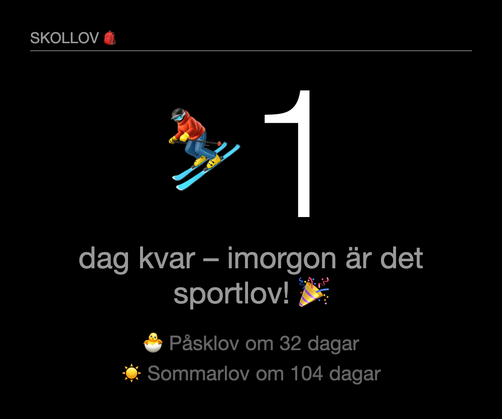
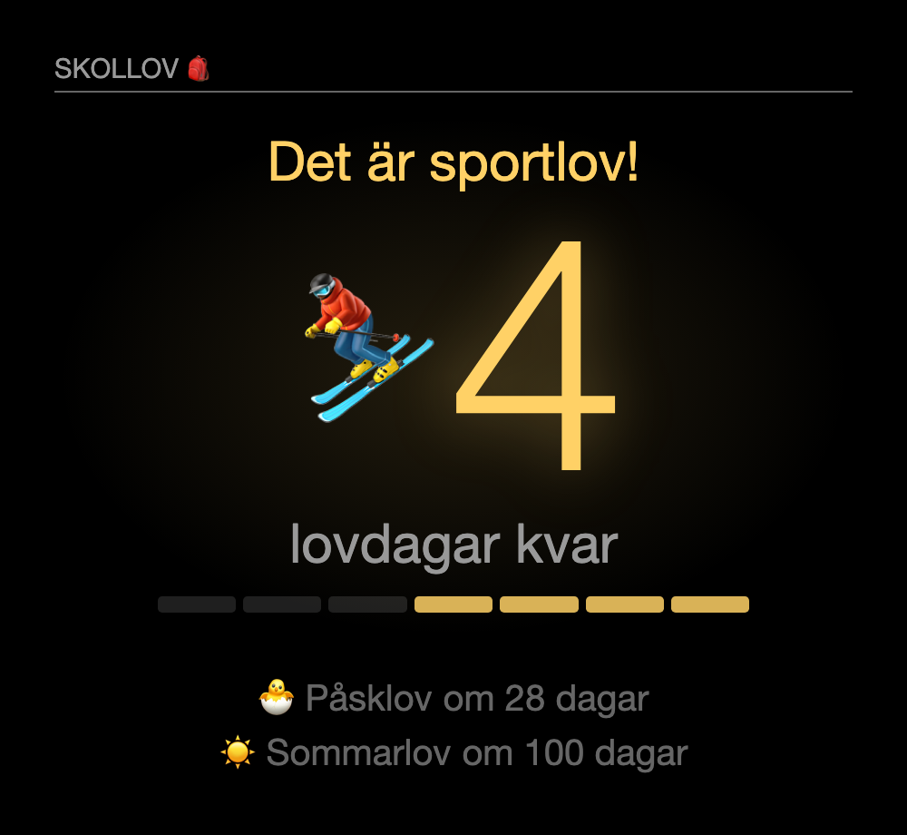
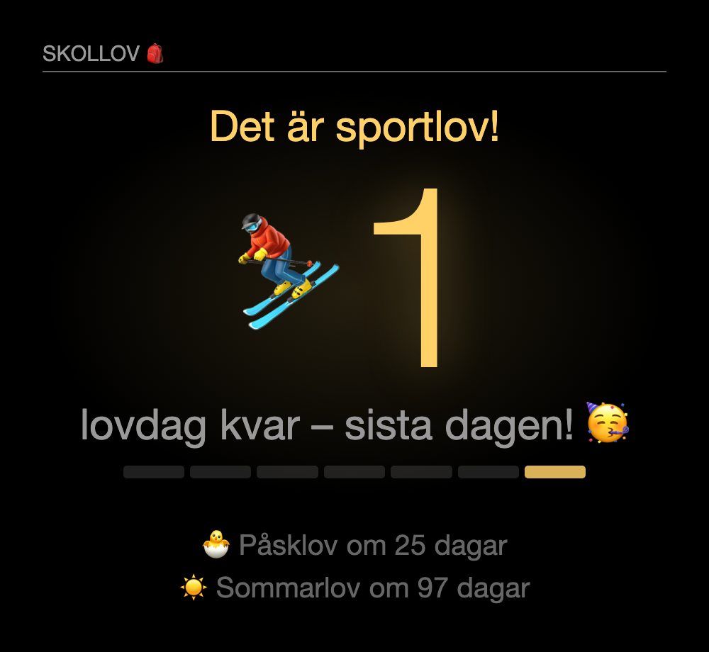
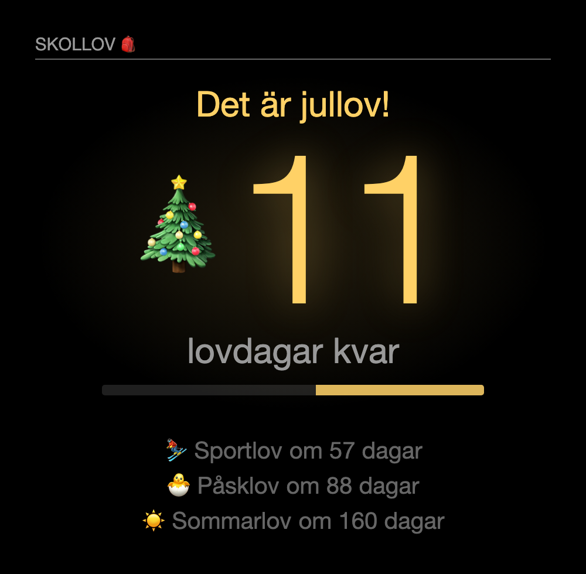
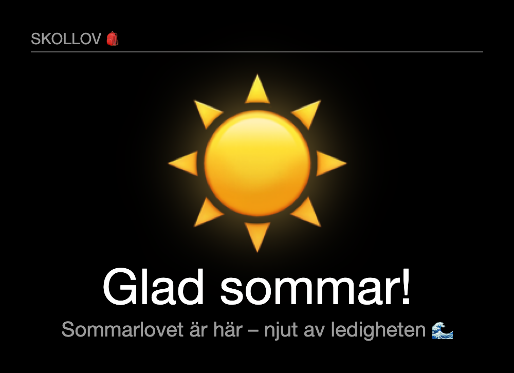

# MMM-Skollov

A [MagicMirror²](https://magicmirror.builders/) module that counts down to Swedish school holidays — höstlov 🍂, jullov 🎄, sportlov ⛷️, påsklov 🐣 and sommarlov ☀️ — in cheerful Swedish, for a family mirror.

It is a **countdown, not a calendar**. The number of days is the hero, large enough to read across a room, with the lov's emoji next to it. Everything else is supporting text. Dates are hidden by default.

- **Before a lov:** days until the first free day, e.g. **🎄 26** "dagar kvar till jullovet!". As it gets close the line changes to "– på lördag!" and then "dag kvar – imorgon är det sportlov! 🎉".
- **During a lov:** the big number becomes the days *left of the holiday*, today included. It is labelled "lovdagar kvar", with a warm glow and "Det är sportlov!" above it, so it can't be mistaken for a countdown. A bar under it shows what is left: one segment per day, with past days going dark and remaining days staying lit.
- **Summer:** once "Sommarlovet börjar" is reached, a big ☀️ and "Glad sommar!" replace the number, with no countdown and no bar. This lasts until around when school restarts.
- **Calendar run out:** if the sun's cutoff passes and skollov.nu still has no new läsår, a plain warning says the calendar has run out.

The optional upcoming list stays in countdown terms ("⛷️ Sportlov om 97 dagar"), smaller and dimmer. The lov name is always shown as text; the emoji are decoration, not the only carrier of meaning.

## Screenshots

Rendered from the real Huddinge 2026/2027 calendar, using `debugDate` to show each state.

<table>
<tr>
<td align="center" width="50%"><br><sub><b>Before a lov</b>: 22 Nov 2026, 26 days to jullov</sub></td>
<td align="center" width="50%"><br><sub><b>The day before</b>: Fri 26 Feb 2027, free from Saturday</sub></td>
</tr>
<tr>
<td align="center"><br><sub><b>During sportlov</b>: 2 Mar 2027, 4 of 7 days left</sub></td>
<td align="center"><br><sub><b>Last day</b>: 5 Mar 2027, one segment left</sub></td>
</tr>
<tr>
<td align="center"><br><sub><b>Long lov</b>: 1 Jan 2027, continuous bar (11 of 25 days)</sub></td>
<td align="center"><br><sub><b>Summer</b>: 15 Jul 2027, the sun until school restarts</sub></td>
</tr>
</table>

## Data source

Dates come from [skollov.nu](https://skollov.nu), which publishes one iCal file per municipality at `https://skollov.nu/kalender/<kommun>.ics`.

> **Note:** skollov.nu lists the dates for **kommunala grundskolor**. Friskolor often set their own holidays and may differ — check with your school.

The module fetches at most once every 12 hours (default once a day) with an identifying User-Agent. The data only changes once a year.

## Installation

```bash
cd ~/MagicMirror/modules
git clone https://github.com/htilly/MMM-Skollov.git
```

There are no npm dependencies, so there is nothing to `npm install`. Node 18 or later is required (for the built-in `fetch`); any current MagicMirror satisfies that.

Emoji need a colour emoji font. On Raspberry Pi OS:

```bash
sudo apt install fonts-noto-color-emoji
```

## Configuration

Add to `config/config.js`:

```js
{
	module: "MMM-Skollov",
	position: "top_right",
	config: {
		kommun: "huddinge",
		showUpcoming: true,
		maxUpcoming: 3
	}
}
```

| Option | Default | Description |
| --- | --- | --- |
| `kommun` | `"huddinge"` | The municipality. Use the slug from the skollov.nu URL, e.g. `https://skollov.nu/kommun/upplands-vasby/` → `"upplands-vasby"`. Plain names such as `"Upplands Väsby"` or `"Göteborg"` are converted automatically. |
| `header` | `"Skollov 🎒"` | Header text above the module. Set to `""` to fall back to MagicMirror's own `header` option (or no header). |
| `showUpcoming` | `true` | Show the holidays after the main one, as "Påsklov om 128 dagar" lines. |
| `maxUpcoming` | `3` | How many entries the upcoming list shows. |
| `updateInterval` | `86400000` (24 h) | How often to fetch from skollov.nu, in milliseconds. Values below 12 hours are raised to 12 hours. Fetching carries on through the summer, so a newly published läsår replaces the sun with a countdown without anyone touching the mirror. |
| `includeWeekendBefore` | `true` | Count down to the first *free* day. When a lov starts on a Monday the family is free from the Saturday before, so the countdown, the holiday state and the bar all start on that Saturday (sportlov 1–5 March shows as seven days, 27 Feb – 5 Mar). Set to `false` to use the official start date. |
| `summerSunUntil` | `"08-20"` | The last day (MM-DD) of the summer sun. Swedish schools restart around week 33–34, and the exact date varies by kommun. If no new läsår has been published by then, the module shows the "calendar has run out" warning instead of a sun that is no longer true. |
| `staleWarningDays` | `30` | Only for calendars that do **not** end with a "Sommarlovet börjar" marker: warn this many days before the data runs out. The normal shape, ending in summer, is covered by the sun instead. |
| `cacheWarningDays` | `3` | If skollov.nu has been unreachable and the module has run on cached data for this many days, say so on the mirror. |
| `showDates` | `false` | Show a small date line under the number ("Ledigt från lördag 27 februari", "Ledigt t.o.m. fredag 5 mars"). |
| `animate` | `true` | Gently bouncing emoji during a lov. Also turned off automatically when the system asks for reduced motion. The bar never animates. |
| `timeZone` | `"Europe/Stockholm"` | The time zone that decides when the day changes. The display updates once, at midnight. |
| `calendarUrl` | `null` | Override the iCal URL. Normally left unset; it is built from `kommun`. |
| `debugDate` | `null` | Pretend today is this date (`"YYYY-MM-DD"`), to preview the states on the mirror. For example `"2027-03-02"` shows sportlov and `"2027-07-15"` shows the sun. Leave unset in normal use. |

## The remaining-days bar

Shown only during a bounded lov. Each segment is one day of the lov, counted from the first free day. Days already over are dark and today onwards are lit, so the first day is fully lit and the last day has exactly one lit segment. The bar's width never changes, so the proportion stays visible. It updates once a day, never during the day: the data is all-day events, and a bar that crept through the afternoon would suggest a precision the data doesn't have.

Holidays longer than 14 days (in practice jullov) use a continuous bar instead, because 25 segments would be slivers. The reasoning is in `MAX_SEGMENTS` in `skollov-core.js`.

## Summer, staleness and caching

Each skollov.nu file covers one **läsår**. Huddinge's 2026/2027 file ends with a one-day "Sommarlovet börjar" event on 10 June 2027. That event marks when summer starts, not a one-day holiday: the calendar has no end date for sommarlov. The module counts down to it like any other lov, then shows the sun.

From then on there is no data because there is no school, so the sun is the honest display. It stays until `summerSunUntil`. After that, if the new läsår still isn't published, the module shows the plain "calendar has run out" warning.

Whether the sun shows depends only on the **dates in the data**, never on whether a fetch worked. A failed fetch in March keeps showing the cached countdown.

- The parsed calendar is cached to `cache/<kommun>.json`. If a fetch fails (network, HTTP error, unparseable or empty response) the cached dates keep being used, so a bad morning at skollov.nu never blanks the mirror.
- A successful fetch replaces the cache. When the next läsår appears, the sun gives way to a countdown to höstlov by itself.
- The cache records when a fetch was last *attempted*, so restarting MagicMirror repeatedly does not cause repeated requests.

## Date handling

All-day iCal events have an **exclusive** end date (RFC 5545): `DTSTART:20270301` / `DTEND:20270306` means 1–5 March, not 1–6. The module subtracts one day from `DTEND`; this is covered by tests against the real Huddinge file. "Lovdagar kvar" counts calendar days including today, so the last day of a lov shows **1** and one lit segment.

Dates are handled as plain calendar dates, and "today" is taken in `Europe/Stockholm`, so daylight-saving changes cannot shift a holiday by a day.

## Development

```bash
npm test
```

Runs the tests with Node's built-in test runner. `test/fixtures/huddinge-2026-2027.ics` is a verbatim copy of the real feed.

Files:

- `MMM-Skollov.js` — the front-end module (rendering only).
- `node_helper.js` — scheduling; all network and disk access goes through `lib/feed.js`.
- `skollov-core.js` — iCal parsing, date maths, state selection and the Swedish copy. Shared by the browser and Node, no side effects.
- `MMM-Skollov.css` — styles.

The iCal parser is a small hand-written one rather than `node-ical`: the feed is five all-day events, and avoiding a dependency means nothing to `npm install` on the Pi and nothing to keep patched. It handles line folding, CRLF/LF, property parameters and text escapes, which is all these files use.
